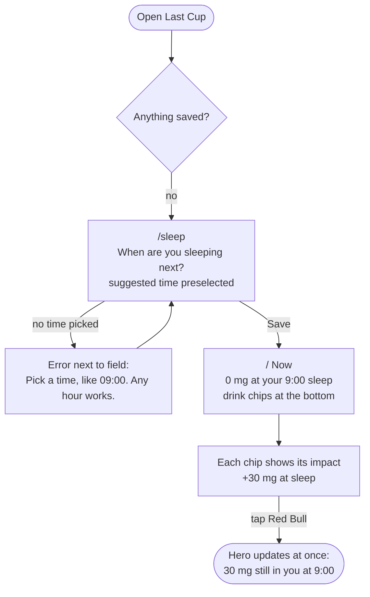
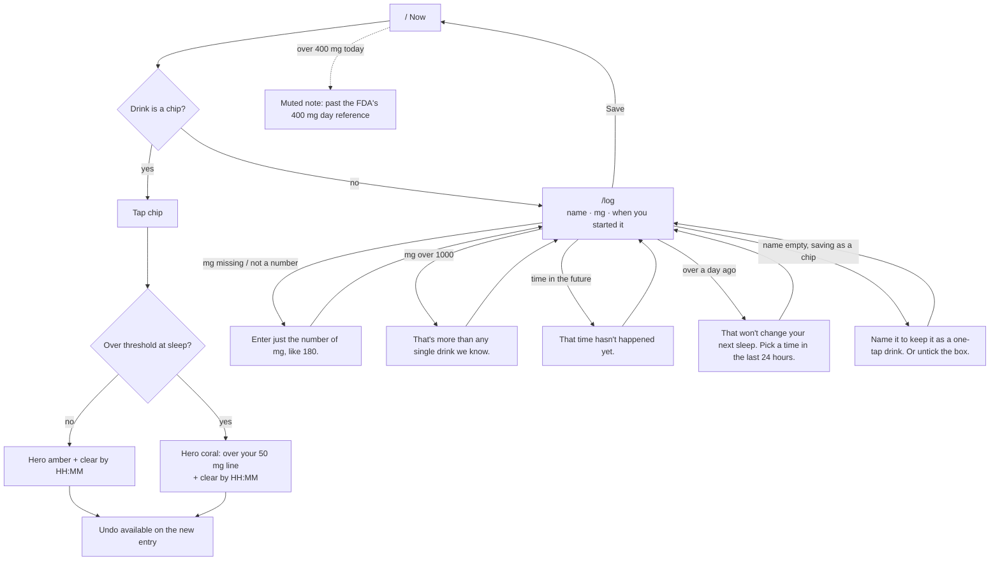
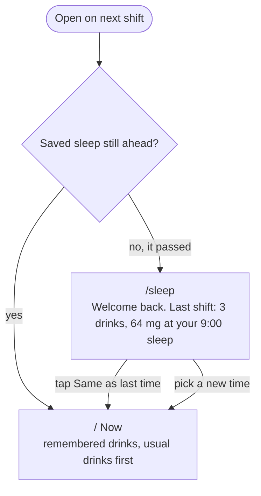

# Last Cup

**See how much caffeine will still be in you when you next sleep, whatever time of day that is.**

Built for people whose bedtime moves: night-shift nurses, rotating-shift healthcare workers, PhD students. Tap the drink you just had. Last Cup tells you how many mg will still be in you at your next sleep, at 9am after a night shift or 3pm on a swing shift, and when you'll be clear. No account, no quiz, nothing leaves your phone.

- Live: https://design-ship-build-homework-3.vercel.app
- Course: MPCS 51238 Design, Build, Ship, Assignment 3 (Patterns & Flows)

## Demo in 30 seconds

1. Open the app. One question: when are you sleeping next? Say 9:00.
2. Tap **Red Bull**. The chip already said "+30 mg at sleep", so you knew before you drank it.
3. Close it. Come back on your next shift: it says "Welcome back", remembers your drinks, and one tap keeps your usual sleep time.

## Flows

Main task, as one sentence:

> I log a Red Bull at 2am on my night shift → it shows how much will still be in me when I sleep at 9am → I come back on my next shift, and it remembers my drinks and my sleep times.

Worked out in plan mode on 16 October 2026. The agent proposed the steps, states and errors below; the user reviewed them and chose to go with the agent's recommendations.

### Steps (one route each, shared bottom nav)

| Route | Step |
|---|---|
| `/sleep` | When are you sleeping next? |
| `/` | Now: what will still be in you at sleep, plus one-tap drinks |
| `/log` | Log a drink that isn't a chip |
| `/settings` | Half-life, sleep threshold, clear data |

### 1. First visit



### 2. Main task: log a drink



### 3. Coming back



### States

- **First visit, nothing saved:** go straight to the sleep question, then the chips. No empty chart.
- **Under the threshold at sleep:** amber hero.
- **Over the threshold at sleep:** coral hero and "clear by HH:MM".
- **Chip would cross the threshold:** the chip's preview turns coral before you tap.
- **Returning, sleep passed:** welcome-back summary and a one-tap "Same as last time".
- **Returning, sleep ahead:** straight to Now.
- **Past 400 mg in 24 h:** a muted note (reference, not advice).
- **Sleep times can't be in the past:** "9:00" means the next time the clock reads 9:00, and the hint spells it out ("That's 9:00 tomorrow, in 7 h"). That removed an error we'd planned, which is simpler than catching it.

The diagrams also live in [`flows.md`](flows.md).

## Research: how similar tools welcome someone new

Three subagents each studied one tool, and a fourth studied night-time visual design. The full notes and sources are in [`research.md`](research.md).

| Tool | What it asks first | Useful after |
|---|---|---|
| RISE | A 30+ step quiz, permissions, then a paywall | About 2 min, and its own help says it fails on rotating shifts |
| Timeshifter Shift Work | An account, your full shift schedule, chronotype | Only once the whole schedule is entered |
| Caffeine Clock / HalfCup | A short setup, no account | Quickly, but it assumes a fixed bedtime |

**Decision:** no quiz and no account. Ask one question, "When are you sleeping next?", where any hour works. Then tapping one chip gives the answer. Rotating shifts are handled by asking for the next sleep each time (one tap keeps the last one) instead of a calendar to fill in.

## What we said no to

- **No chart library.** One curve doesn't justify a dependency, so it's hand-drawn SVG ([`DecayCurve.tsx`](src/components/DecayCurve.tsx)).
- **No date library.** "Next 9:00" and "in 7 h" are a few lines in [`time.ts`](src/lib/time.ts).
- **No backend, accounts or sync.** One `localStorage` key holds everything, and a nurse at 3am shouldn't have to sign in.
- **No onboarding tour or quiz.** The research above showed that's where the other tools lose people.

The only runtime dependencies are `next`, `react` and `react-dom`.

## The model

One-compartment exponential decay, `remaining = dose × 0.5^(hours / halfLife)`, summed over every drink. The half-life defaults to 5 h (adjustable from 2 to 10 h, since people vary). Absorption is treated as instant. The 50 mg sleep line is an adjustable heuristic, not medical advice. The 400 mg/day figure is the FDA's reference for most adults. Sources for every drink's mg value are in [`src/lib/drinks.ts`](src/lib/drinks.ts) and [`research.md`](research.md).

## Accessibility

- **Keyboard:** every control is a real `<button>`, `<a>` or `<input>`. Tab order on Now: sleep time → drink chips → Other → history → nav. A 3px amber focus ring shows on every one (checked in headless Chrome, 16–17 Oct 2026).
- **Labels:** every input has a `<label for>`. Hints and errors are tied to their input with `aria-describedby`, and invalid fields get `aria-invalid`. On a failed submit, focus moves to the first field to fix, and nothing typed is cleared.
- **Live updates:** the hero number and the "Logged / Removed …, Undo" line are `aria-live="polite"`. Each chip's accessible name says what it adds at sleep.
- **Structure:** each route has its own page title ("Log a drink · Last Cup") and one `<h1>`. Units shown inside inputs ("mg") are also in the label for screen readers ("Caffeine, in mg").
- **Contrast** (WCAG formula, computed by script, not eyeballed):

| Pair | Ratio | Needs |
|---|---|---|
| text `#E8DCCB` on bg `#14110F` | 13.9 | 4.5 |
| muted `#A8998A` on bg | 6.8 | 4.5 |
| muted on raised `#2A231D` | 5.6 | 4.5 |
| amber `#F2A541` on bg | 9.2 | 4.5 |
| coral `#E0705A` on bg / raised | 5.9 / 4.9 | 4.5 |
| bg on amber (primary button) | 9.2 | 4.5 |
| input edge `#7A6B5D` on surface `#1F1A16` | 3.4 | 3 (UI) |

## First-run check

On 17 October 2026 a fresh subagent used the **deployed URL** as a brand-new user. It didn't read the code. It drove headless Chrome at phone size (390×844), with the timezone set so the local time was 2:45am.

**Its persona and goal:** a night-shift ICU nurse at 2:45am who has just finished a Red Bull, sleeps at 9:00 after the shift, and wants to know whether that Red Bull will wreck their sleep. Later they buy a 180 mg café coffee that isn't a preset. They come back on the next shift.

**What happened:**
- **First visit:** the sleep time was already filled in as 09:00. Tapping Next, then Red Bull, showed **"34 mg still in you at your 9:00 sleep"**. That's 2 taps and about 10 seconds. The tester checked the maths by hand (80 × 0.5^(6.25/5) ≈ 34).
- **Main task:** a tired "180mg large" with a blank name gave two errors, each under its field, and kept what was typed. A typo of "1800" was caught. After the coffee, the hero turned coral: 110 mg, clear by 14:40.
- **Coming back:** all saved times were moved back 22 h. The app opened on "Welcome back. Last shift: 2 drinks, 110 mg", and one tap got back to Now with the drinks and the custom coffee chip still there.

**Its feedback, and what changed:**

| Feedback (most important first) | Change |
|---|---|
| "Log drink" is half hidden behind the bottom nav, and fully hidden once an error appears | A shared `ActionBar` pins the main action above the nav on both forms (`08a0b2d`) |
| Chips show "+34 at sleep" but never the dose, so someone with a bigger can can't tell the app assumed 80 mg | Each chip shows its mg (`6d127a5`) |
| The "now" dot sits at 0 mg right after a drink, while the curve jumps to 80 | The dot is placed at the exact current total, and doses draw as steps (`24d2281`) |
| Coral chips are never explained | A one-line key under the chips (`6d127a5`) |
| Logging from the form gives no confirmation; Remove deletes with no undo | One "Logged / Removed …, Undo" line for all three (`9521e38`) |
| "180mg large" is rejected though the number is right there | The leading number is read; the error now says "Enter just the number of mg, like 180" (`e9233e5`) |
| A one-off drink shouldn't need a name | The name is only required when saving it as a chip (`e9233e5`) |
| Nothing shows how much is in me *now* | "Last 24 hours: 260 mg drunk, 260 mg in you now", seen right after both drinks (`9c675bd`) |
| "4:48" on the next shift doesn't say it was yesterday | "yesterday 4:48" (`9c675bd`) |
| "Same time" next to "Save sleep time" is unclear; the intro sits above the question | "Same as last time" vs "Use the time above"; the question comes first (`a3f9500`) |
| The caveats are only in Settings | "An estimate, not medical advice…" under the curve, linking to Adjust (`993485f`) |
| The "1"s in the hero look like stray strokes | Proportional figures for the hero (`5300d25`) |
| The focus ring on the Now tab is clipped by the screen edge | The ring is drawn inside the tab (`5405945`, `033ecf5`) |
| Settings save silently | "Changes save as you make them." (`ad8e281`) |
| The 80 mg placeholder looks pre-filled | Removed (`e9233e5`) |

**Not changed:** adding a custom chip pushes the fifth built-in (Espresso) to "More drinks" on /log. That's intended: the grid shows the five drinks you use most.

**Re-check:** the same scenarios were run again against a production build of the fixed code (`next start` on fe02), with screenshots, before pushing.

## How this was built with an agent

- **Plan mode first:** the main task as one sentence, then the agent proposed steps, states and errors, and we picked from them. That's the source of [`flows.md`](flows.md).
- **Subagents for research:** four ran in parallel (three tools and night-time visual design), then the decision was written down in [`research.md`](research.md).
- **[`AGENTS.md`](AGENTS.md) as the context file:** it records the brief's hard rules (no backend, no new packages, shared components, error wording) and the design tokens, so every session started from them.
- **Checking instead of trusting:** contrast was computed by script, keyboard order and the flows were checked in headless Chrome, and [`CHECKLIST.md`](CHECKLIST.md) only gets a tick once something is verified.
- **Easy:** small, single-purpose commits, and building the shared components first.
- **Hard:**
  - The fonts weren't loading at first, which only showed up on a real render (`86f8e05`).
  - A drink logged within 30 s of the clock tick didn't count yet (`84fa5de`).
  - The first-run tester's own browser was killed before `localStorage` reached disk, which looked like an app bug until it was traced.

## Run it

```bash
npm install
npm run dev
```

Next.js (App Router) and Tailwind CSS. Data is saved in `localStorage` only.
