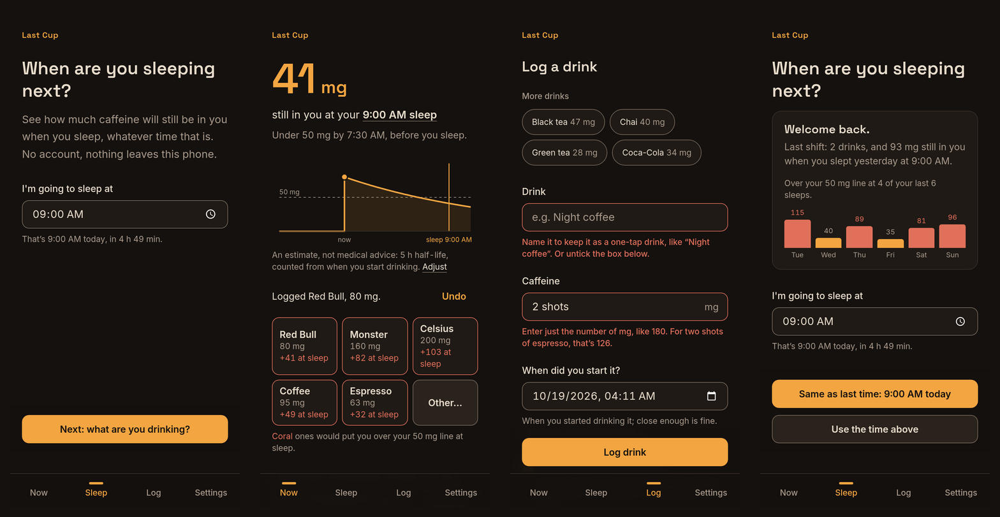
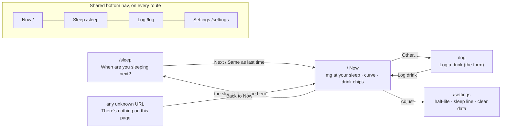
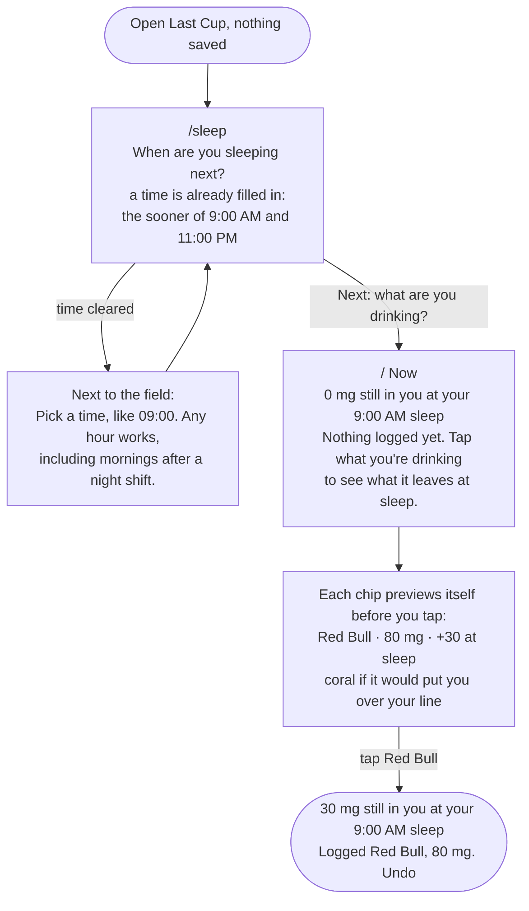
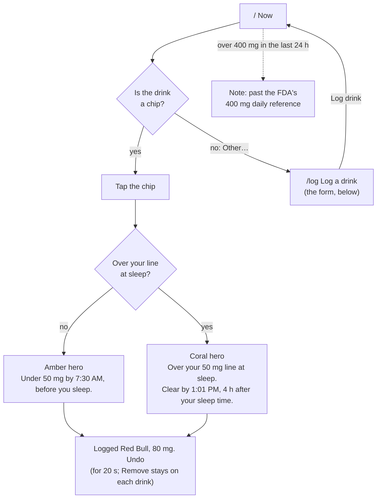
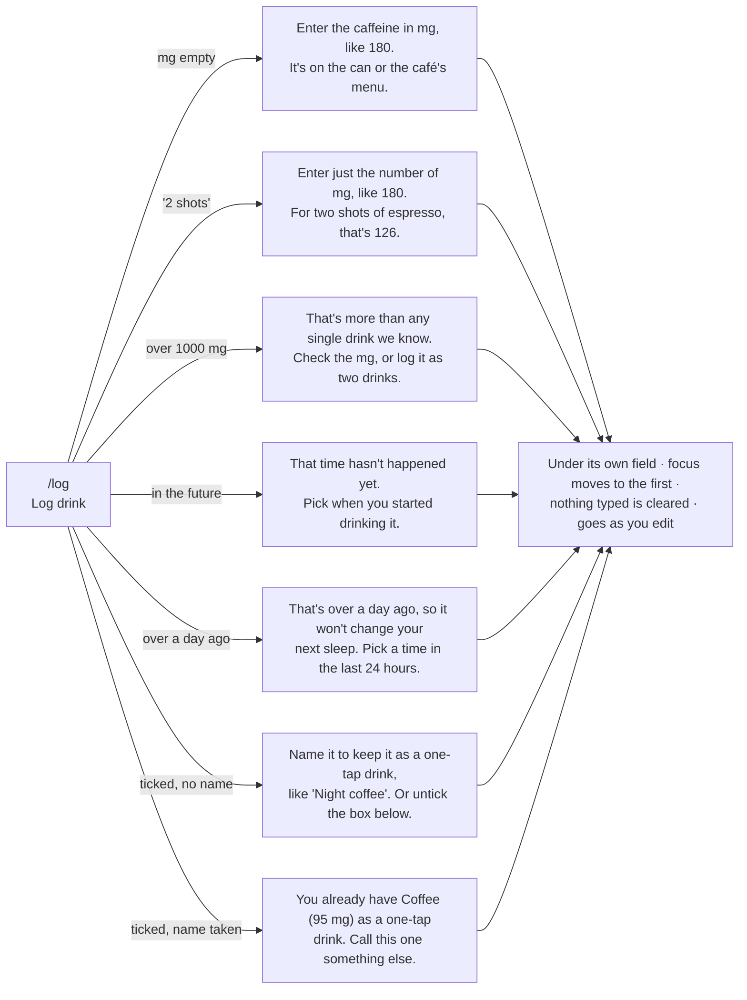
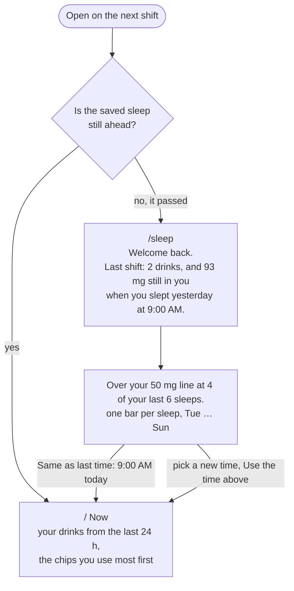

# Last Cup

**See how much caffeine will still be in you when you next sleep, whatever time of day that is.**

Built for people whose bedtime moves: night-shift nurses, rotating-shift healthcare workers, PhD students. Tap the drink you just had, and Last Cup tells you how many mg will still be in you at your next sleep, whether that's 9am after a night shift or 1am after a thesis day, and when you'll be clear. No account, no quiz, nothing leaves your phone.

**Live:** https://design-ship-build-homework-3.vercel.app · **Course:** MPCS 51238 Design, Build, Ship, Assignment 3 (Patterns & Flows)



<sub>1 First visit: one question, already answered · 2 One tap later: what's left at sleep · 3 The form: errors next to each field, input kept · 4 Coming back: last shift and recent sleeps. Live site, phone size, 4am.</sub>

## Demo in 30 seconds

1. Open the app. One question: when are you sleeping next? At 4am it has already filled in 9:00 AM. Tap **Next**.
2. Every drink shows what it would leave at sleep *before* you tap it: "Red Bull · 80 mg · +30 at sleep". Tap **Red Bull**: "30 mg still in you at your 9:00 AM sleep".
3. Come back on your next shift: "Welcome back. Last shift: 2 drinks, and 93 mg still in you when you slept yesterday at 9:00 AM", a bar for each recent sleep, and one tap for "Same as last time".

## Where each part of the brief is

| The brief asks for | Where it is |
|---|---|
| A live Vercel URL that works | https://design-ship-build-homework-3.vercel.app (every route checked in headless Chrome, phone and desktop) |
| A tool built around its flows, a page per step, shared navigation | `/sleep`, `/`, `/log`, `/settings`, all in one `Screen` frame with the bottom nav. See [Flows](#flows) |
| Flows as a diagram in the README | [Flows](#flows): five Mermaid diagrams, also in [`flows.md`](flows.md) |
| Steps, states and errors from the agent, and the user choosing | [Plan mode](#plan-mode-what-the-agent-proposed-and-what-we-kept): what was proposed, kept and cut |
| Three similar tools researched by subagents | [Research](#research-how-similar-tools-welcome-someone-new), full notes in [`research.md`](research.md) |
| A first visit that's useful right away | Two taps to the answer, with no empty chart (screens 1 and 2 above) |
| A form with errors next to the field that say what to do, keeping what was typed | `/log`: seven errors, each under its field; typed text kept on error *and* if you leave the page (screen 3) |
| A reason to come back, and a tool that remembers | Welcome back with last shift and recent sleeps; everything in `localStorage` (screen 4) |
| Keyboard, labels, contrast checked with the agent | [Accessibility](#accessibility), plus [`scripts/contrast.mjs`](scripts/contrast.mjs) |
| The first-run check and its feedback | [First-run check](#first-run-check): two rounds, every item mapped to a commit |
| Commits that show progress | About 60 small commits, from the first flow to the fixes |
| `AGENTS.md` as the context file | [`AGENTS.md`](AGENTS.md); no `CLAUDE.md`; `/context` shows it loaded |

## Flows

Main task, as one sentence:

> I log a Red Bull at 2am on my night shift → it shows how much will still be in me when I sleep at 9am → I come back on my next shift, and it remembers my drinks and my sleep times.

### Routes and navigation

One route per step. Every route sits in the same `Screen` frame, with the shared bottom nav (the current tab is amber and marked `aria-current="page"`) and the "Last Cup" wordmark, which links back to Now.



### 1. First visit: useful right away



Two taps from opening the app to the answer. No account, no quiz, no tour, and never an empty chart.

### 2. Main task: log a drink



#### The form and its errors (`/log`)

Fields: **Drink** (optional for a one-off) · **Caffeine, in mg** · **When did you start it?** (defaults to now) · ☐ **Add it to my one-tap drinks** (unticked).



"180", "180 mg", "180mg large" and "1,000" are all read as numbers. Leave mid-form and come back, and the form says "Kept what you typed last time" with a **Start over** button.

### 3. Coming back: it remembers



Everything lives in `localStorage` on this device (`lastcup:v1`, plus `lastcup:draft` for a half-filled form): drinks for 30 days, the next sleep, the last 14 sleeps, settings and custom chips.

### States

| State | What you see |
|---|---|
| First visit, nothing saved | The sleep question with a time filled in, then chips that preview their effect. No empty chart. |
| Nothing logged yet | "0 mg" and "Nothing logged yet. Tap what you're drinking…" right above the chips |
| Under your line at sleep | Amber hero, "Under 50 mg by 7:30 AM, before you sleep." |
| Over your line at sleep | Coral hero, "Over your 50 mg line at sleep. Clear by …" |
| A chip would push you over | That chip turns coral before you tap, with a one-line key |
| Already over | "You're already over your 50 mg line at sleep, so each one adds to it." |
| Just logged or removed | "Logged Red Bull, 80 mg. Undo" for 20 s |
| Past 400 mg in 24 h | A muted note (a reference, not advice) |
| Returning, sleep passed | Welcome back, last shift, bars for recent sleeps, one-tap "Same as last time" |
| Returning, sleep still ahead | Straight to Now |
| Half-filled form | "Kept what you typed last time. Start over" |
| Unknown URL | "There's nothing on this page", with Back to Now |
| Storage blocked (private mode) | Works for the visit, kept in memory |

**A sleep time can't be in the past, by design.** "9:00" means the next time the clock reads 9:00, and the hint spells it out ("That's 9:00 AM today, in 4 h 49 min"). That removed an error we had planned, which is simpler than catching it.

## Plan mode: what the agent proposed and what we kept

In plan mode on 16 October 2026, the agent proposed the routes, states and errors below, and I went through them in chat one question at a time. I took its recommended set, and that set already cut two of its own proposals. Building and the first-run checks cut or changed more.

| The agent proposed | Decision | Why |
|---|---|---|
| Route `/` Now: hero, curve, chips | **Kept** | It's the main task |
| Route `/sleep`: next sleep | **Kept** | The question that makes rotating shifts work |
| Route `/log`: the custom drink form | **Kept** | The form the brief asks for |
| Route `/history`: past drinks and sleeps | **Cut** | You only act on the last 24 h, so it's a list on Now. Past *sleeps* came back later as bars on the welcome-back card |
| Route `/settings`: half-life, sleep line | **Kept** | People's half-life varies from 3 to 7 h |
| State: first visit, nothing saved | **Kept** | No empty chart: the question, then chips |
| State: over the line at sleep | **Kept** | A coral hero and "Clear by …" |
| State: confirm before logging ("this puts you at 110 mg"), one extra tap | **Cut** | Replaced by chips that show "+40 at sleep" *before* you tap: the same warning with no extra step |
| State: returning after the sleep has passed | **Kept** | Became the welcome-back card |
| Error: mg missing or not a number | **Kept, then split** | "2 shots" needs a different message from an empty field |
| Error: mg over 1000 | **Kept** | Catches a typo like 1800 |
| Error: drink time in the future | **Kept** | |
| Error: sleep time in the past | **Cut** | Made impossible: "9:00" means the *next* 9:00, and the hint says which day |
| Error: drink name empty | **Narrowed** | First-run check: a one-off shouldn't need a name, so it's only needed when saving a chip |
| Coming back: a welcome-back summary *or* straight to Now | **Both** | The summary once the sleep has passed; straight to Now when it's still ahead |

Added later, not proposed: the "over a day ago" error, the clashing-chip-name error, keeping a half-filled form, and the recent-sleeps bars.

## Research: how similar tools welcome someone new

Three subagents each studied one tool, and a fourth studied night-time visual design. The full notes and sources are in [`research.md`](research.md).

| Tool | What it asks first | Useful after |
|---|---|---|
| RISE | A 30+ step quiz, permissions, then a paywall | About 2 min, and its own help says it fails on rotating shifts |
| Timeshifter Shift Work | An account, your full shift schedule, chronotype | Only once the whole schedule is entered |
| Caffeine Clock / HalfCup | A short setup, no account | Quickly, but it assumes a fixed bedtime |

**Decision:** no quiz and no account. Ask one question, "When are you sleeping next?", where any hour works. Then tapping one chip gives the answer. Rotating shifts are handled by asking for the next sleep each time (one tap keeps the last one) instead of a calendar to fill in.

## What we said no to

- **No chart library.** One curve doesn't justify a dependency, so it's hand-drawn SVG ([`DecayCurve.tsx`](src/components/DecayCurve.tsx)).
- **No date library.** "Next 9:00" and "in 7 h" are a few lines in [`time.ts`](src/lib/time.ts).
- **No backend, accounts or sync.** One `localStorage` key holds everything, and a nurse at 3am shouldn't have to sign in.
- **No onboarding tour or quiz.** The research above showed that's where the other tools lose people.

The only runtime dependencies are `next`, `react` and `react-dom`.

## First-run check

The brief asks the agent to use the deployed tool as a brand-new user. We did this twice, each time with a fresh subagent that didn't read the code. It drove headless Chrome on the **live URL** with a no-dependency DevTools script.

### Round 1: night-shift nurse, 17 October

**Its persona and goal:** a night-shift ICU nurse at 2:45am who has just finished a Red Bull, sleeps at 9:00 after the shift, and wants to know whether that Red Bull will wreck their sleep. Later they buy a 180 mg café coffee that isn't a preset. They come back on the next shift.

**What happened:**
- **First visit:** the sleep time was already filled in as 09:00. Tapping Next, then Red Bull, showed **"34 mg still in you at your 9:00 sleep"**. That's 2 taps and about 10 seconds. The tester checked the maths by hand (80 × 0.5^(6.25/5) ≈ 34).
- **Main task:** a tired "180mg large" with a blank name gave two errors, each under its field, and kept what was typed. A typo of "1800" was caught. After the coffee, the hero turned coral: 110 mg, clear by 14:40.
- **Coming back:** all saved times were moved back 22 h. The app opened on "Welcome back. Last shift: 2 drinks, 110 mg", and one tap got back to Now with the drinks and the custom coffee chip still there.

**Its feedback, and what changed:**

| Feedback (most important first) | Change |
|---|---|
| "Log drink" is half hidden behind the bottom nav, and fully hidden once an error appears | A shared `ActionBar` pins the main action above the nav on both forms (`08a0b2d`) |
| Chips show "+34 at sleep" but never the dose, so someone with a bigger can can't tell the app assumed 80 mg | Each chip shows its mg (`6d127a5`) |
| The "now" dot sits at 0 mg right after a drink, while the curve jumps to 80 | The dot is placed at the exact current total, and doses draw as steps (`24d2281`) |
| Coral chips are never explained | A one-line key under the chips (`6d127a5`) |
| Logging from the form gives no confirmation; Remove deletes with no undo | One "Logged / Removed …, Undo" line for all three (`9521e38`) |
| "180mg large" is rejected though the number is right there | The leading number is read; the error now says "Enter just the number of mg, like 180" (`e9233e5`) |
| A one-off drink shouldn't need a name | The name is only required when saving it as a chip (`e9233e5`) |
| Nothing shows how much is in me *now* | "Last 24 hours: 260 mg drunk, 260 mg in you now", seen right after both drinks (`9c675bd`) |
| "4:48" on the next shift doesn't say it was yesterday | "yesterday 4:48" (`9c675bd`) |
| "Same time" next to "Save sleep time" is unclear; the intro sits above the question | "Same as last time" vs "Use the time above"; the question comes first (`a3f9500`) |
| The caveats are only in Settings | "An estimate, not medical advice…" under the curve, linking to Adjust (`993485f`) |
| The "1"s in the hero look like stray strokes | Proportional figures for the hero (`5300d25`) |
| The focus ring on the Now tab is clipped by the screen edge | The ring is drawn inside the tab (`5405945`, `033ecf5`) |
| Settings save silently | "Changes save as you make them." (`ad8e281`) |
| The 80 mg placeholder looks pre-filled | Removed (`e9233e5`) |

**Not changed:** adding a custom chip pushes the fifth built-in (Espresso) to "More drinks" on /log. That's intended: the grid shows the five drinks you use most.

**Re-check:** the same scenarios were run again against a production build of the fixed code (`next start` on fe02), with screenshots, before pushing.

### Round 2: PhD student, 19 October

ROUND2_PLACEHOLDER

## A strict review against the brief

After round 1, a separate subagent graded the repo and the live site cold, as the strictest TA it could be, against every line of the brief. It found two rubric risks and nine bugs the first-run check hadn't, including one where this README claimed a fix that wasn't there: the "Add to my one-tap drinks" box was ticked by default, so a blank name always errored. Every finding and its fix is in [`CHECKLIST.md`](CHECKLIST.md) section G. The biggest ones:

| Finding | Change |
|---|---|
| "Save what the person typed" only held on an error; leaving `/log` lost it | The form is kept until the drink is logged, with "Start over" (`f4c5cf9`) |
| The README said the user just took the agent's recommendations | The [Plan mode](#plan-mode-what-the-agent-proposed-and-what-we-kept) table, taken from the session |
| The one-tap box was ticked by default, so a one-off needed a name | Unticked by default (`8b01dc6`) |
| "2 shots" logged 2 mg; "1,000" logged 1 mg | Strict parsing with a specific error (`8b01dc6`) |
| A custom "Coffee" silently didn't become a chip | An error next to the name (`8b01dc6`) |
| "Under 50 mg by 9:02, before you sleep" at a 9:00 sleep (rounding) | One rounding rule (`3e64afb`) |
| Coming back only remembered last shift | Recent sleeps as bars: "Over your line at 4 of your last 6 sleeps" (`9ae97a9`) |
| At 7:15am it suggested 11:00 PM for a nurse just off shift | The sooner of 9:00 and 23:00 (`05dfe5c`) |
| 24 h times in the app, 12 h in the pickers | One format, the device's (`84d06e6`) |
| `/log` hand-rolled its pills and checkbox | Shared `Pill` and `Checkbox` (`1c41078`) |
| Chip edges at 1.3:1 | 3.7:1 (WCAG 1.4.11) (`48deae7`) |
| No screenshots in the README; a phone column on a laptop | The strip above; two columns on desktop (`2e3f2f8`) |

## Accessibility

- **Keyboard:** every control is a real `<button>`, `<a>` or `<input>`. Tab order on Now: wordmark → sleep time → Adjust → drink chips → Other… → history → nav. A 3px amber focus ring shows on every one, and the nav draws its ring inside the tab so the screen edge can't clip it. Checked in headless Chrome by tabbing and printing the focused element.
- **Labels:** every input has a `<label for>`, including the checkbox (the shared `Field` and `Checkbox`). Hints and errors are tied to their input with `aria-describedby`, and invalid fields get `aria-invalid`. On a failed submit, focus moves to the first field to fix, and nothing typed is cleared.
- **Live updates:** the hero number and the "Logged / Removed …, Undo" line are `aria-live="polite"`. Each chip's accessible name says what it adds at sleep. Each bar on the welcome-back card has a text equivalent ("93 mg when you slept yesterday at 9:00 AM").
- **Structure:** a page title per route ("Log a drink · Last Cup") and one `<h1>` each. Units shown inside inputs ("mg") are in the label for screen readers ("Caffeine, in mg").
- **Contrast**, computed by the agent with [`scripts/contrast.mjs`](scripts/contrast.mjs) (WCAG 2.1 formula, no packages). Run `node scripts/contrast.mjs`; it exits non-zero if any pair fails.

| Text | On | Ratio | Needs | Used for |
|---|---|---|---|---|
| text `#e8dccb` | bg `#14110f` | 13.9 ✓ | 4.5 | body text, headings, drink names in the list |
| text `#e8dccb` | surface `#1f1a16` | 12.8 ✓ | 4.5 | drink chip names, typed input text |
| text `#e8dccb` | raised `#2a231d` | 11.4 ✓ | 4.5 | secondary buttons (Other…, Clear my data) |
| muted `#a8998a` | bg `#14110f` | 6.8 ✓ | 4.5 | hints, captions, inactive nav tabs |
| muted `#a8998a` | surface `#1f1a16` | 6.2 ✓ | 4.5 | chip mg, input placeholder and unit, welcome-back text |
| muted `#a8998a` | raised `#2a231d` | 5.6 ✓ | 4.5 | chip text on hover |
| amber `#f2a541` | bg `#14110f` | 9.2 ✓ | 4.5 | hero number, wordmark, Undo/Remove, active nav tab |
| amber `#f2a541` | surface `#1f1a16` | 8.4 ✓ | 4.5 | half-life value |
| coral `#e0705a` | bg `#14110f` | 5.9 ✓ | 4.5 | field errors, over-the-line hero and text |
| coral `#e0705a` | surface `#1f1a16` | 5.4 ✓ | 4.5 | '+78 at sleep' on a chip that would cross the line |
| coral `#e0705a` | raised `#2a231d` | 4.9 ✓ | 4.5 | chip hover while coral |
| bg `#14110f` | amber `#f2a541` | 9.2 ✓ | 4.5 | primary button label |
| edge `#7a6b5d` | surface `#1f1a16` | 3.4 ✓ | 3 | input borders (non-text UI) |
| edge `#7a6b5d` | bg `#14110f` | 3.7 ✓ | 3 | secondary button border (non-text UI) |

## The model

One-compartment exponential decay, `remaining = dose × 0.5^(hours / halfLife)`, summed over every drink. The half-life defaults to 5 h (adjustable from 2 to 10 h, since people vary). Absorption is treated as instant. The 50 mg sleep line is an adjustable heuristic, not medical advice. The 400 mg/day figure is the FDA's reference for most adults. Sources for every drink's mg value are in [`src/lib/drinks.ts`](src/lib/drinks.ts) and [`research.md`](research.md).

## How this was built with an agent

- **Plan mode first.** The main task as one sentence, then the agent proposed steps, states and errors, and we cut and kept ([table above](#plan-mode-what-the-agent-proposed-and-what-we-kept)).
- **Subagents for research.** Four ran in parallel (three tools and night-time visual design), and the decision was written down in [`research.md`](research.md).
- **[`AGENTS.md`](AGENTS.md) as the context file.** It records the brief's hard rules (no backend, no new packages, shared components, error wording) and the design tokens, so every session started from them.
- **Subagents as testers and as a strict grader.** Two first-run checks on the live URL, and one cold review against the brief. Each found things the others missed.
- **Checking instead of trusting.** Contrast is a script, the flows and the keyboard order were checked in headless Chrome, the diagrams were rendered to check they parse, and [`CHECKLIST.md`](CHECKLIST.md) only gets a tick once something has been verified.
- **Easy:** small, single-purpose commits, and building the shared components first, so most fixes were one file.
- **Hard:**
  - The fonts weren't loading at first, which only showed up on a real render (`86f8e05`).
  - A drink logged within 30 s of the clock tick didn't count yet (`84fa5de`).
  - The first-run tester's own browser was killed before `localStorage` reached disk, which looked like an app bug until it was traced.
  - Our own README overclaimed a fix (the optional name). Only an outside review caught it, which is why we now verify each claim in the running app before ticking it.

## Run it

```bash
npm install
npm run dev               # http://localhost:3000
node scripts/contrast.mjs # contrast check
```

Next.js 15 (App Router) and Tailwind CSS 4. The only runtime dependencies are `next`, `react` and `react-dom`. Data is saved in `localStorage` only.
