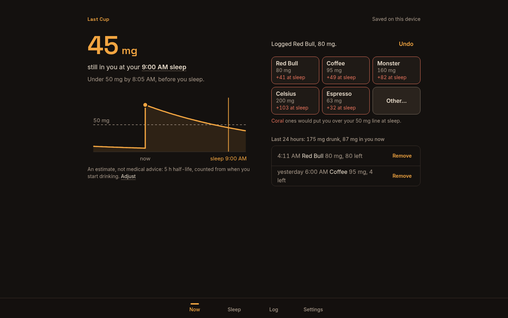
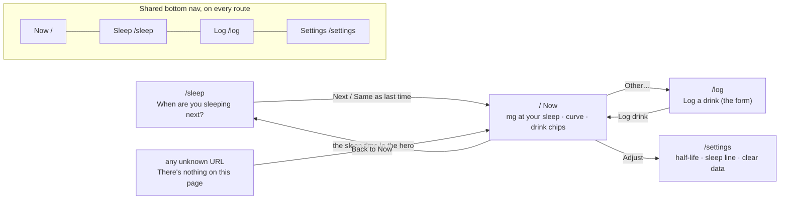
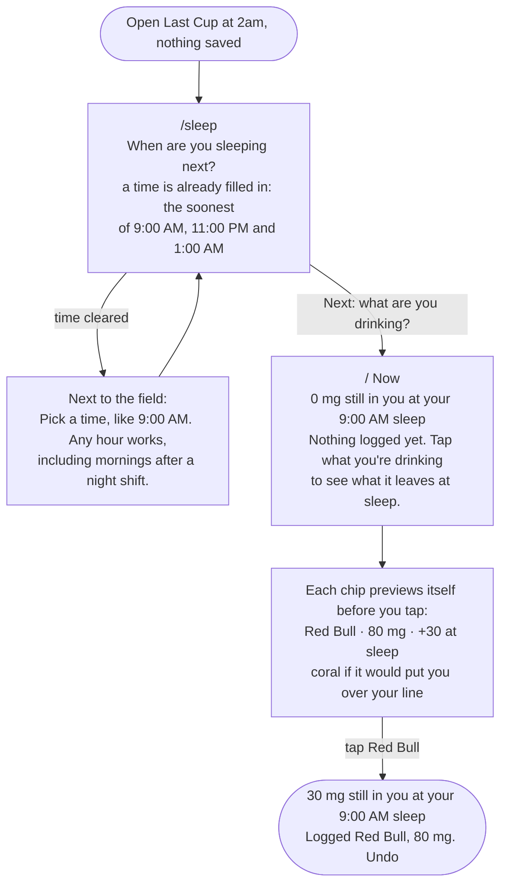
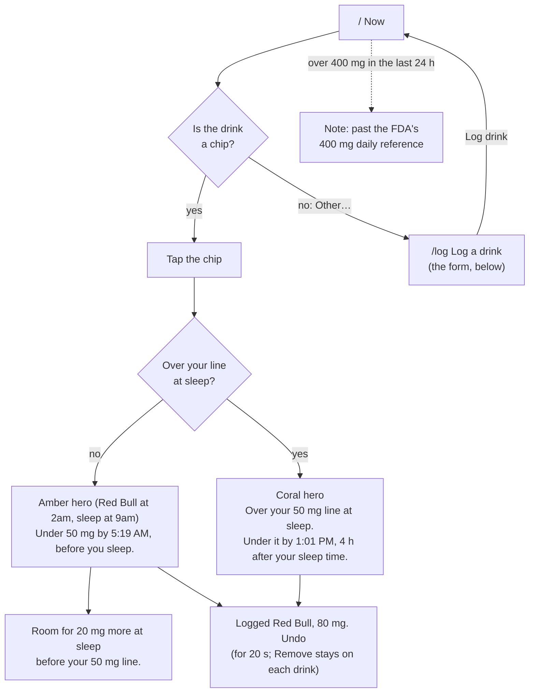
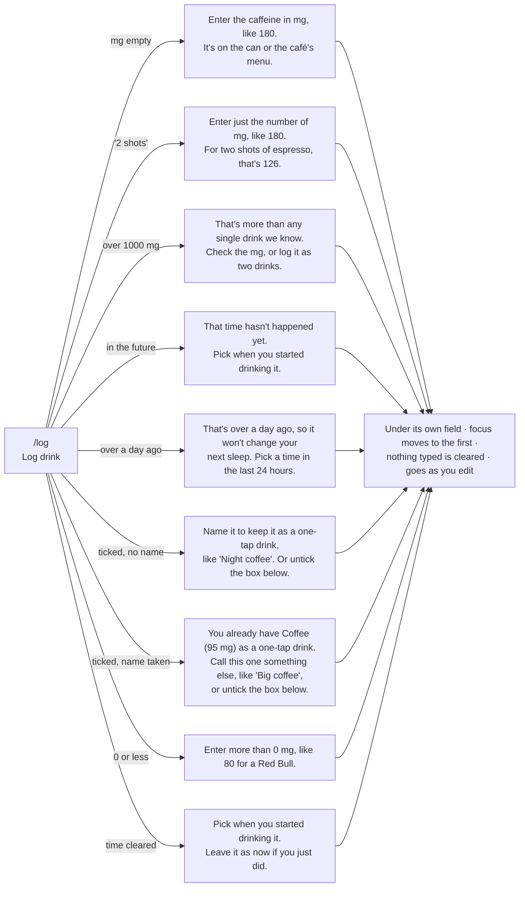

# Last Cup

**See how much caffeine will still be in you when you next sleep, whatever time of day that is.**

Built for people whose bedtime moves: night-shift nurses, rotating-shift healthcare workers, PhD students. Tap the drink you just had, and Last Cup tells you how many mg will still be in you at your next sleep, whether that's 9am after a night shift or 1am after a thesis day, and when you'll be clear. No account, no quiz, nothing leaves your phone.

**Live:** https://design-ship-build-homework-3.vercel.app · **Code:** https://github.com/nocturnalvigilante/design_ship_build_homework_3 · **Course:** MPCS 51238 Design, Build, Ship, Assignment 3 (Patterns & Flows)


<sub>1 First visit: one question, already answered · 2 One tap later: what's left at sleep · 3 The form: errors next to each field, input kept · 4 Coming back: last time and recent sleeps. Live site, phone size, 4:27am.</sub>

On a laptop, Now uses two columns:



## Demo in 30 seconds

1. Open the app. One question: when are you sleeping next? At 4:27am it has already filled in 9:00 AM. Tap **Next**.
2. Every drink shows what it would leave at sleep *before* you tap it: "Red Bull · 80 mg · +43 at sleep". Tap **Red Bull**: "43 mg still in you at your 9:00 AM sleep", "Under 50 mg by 7:46 AM, before you sleep", and "Room for 7 mg more" (screen 2).
3. Come back on your next shift: "Welcome back. Last time: 2 drinks, and 96 mg still in you when you slept yesterday at 9:00 AM", a bar for each recent sleep, and one tap for "Same as last time".

## Where each part of the brief is

| The brief asks for | Where it is |
|---|---|
| A live Vercel URL that works | https://design-ship-build-homework-3.vercel.app (every route checked in headless Chrome at 320, 390 and 1440 px) |
| A tool built around its flows, a page per step, shared navigation | Each step's route is in [Steps and routes](#steps-and-routes); all routes share one `Screen` frame and bottom nav |
| Flows as a diagram in the README | [Flows](#flows): five Mermaid diagrams, also in [`flows.md`](flows.md) |
| Flows worked out with the agent; steps, states and errors proposed, and me choosing | [Decisions I made](#decisions-i-made) and [Plan mode](#plan-mode-what-the-agent-proposed-and-where-it-ended-up) |
| Three similar tools researched by subagents | [Research](#research-how-similar-tools-welcome-someone-new); notes in [`research.md`](research.md); one subagent's [prompt and report](docs/evidence/research-subagent-rise.md) |
| A first visit that's useful right away | Two taps to the answer, with no empty chart (screens 1 and 2 above) |
| A form with errors next to the field that say what to do, keeping what was typed | `/log`: ten error messages, each under its field; what you typed is kept on an error *and* if you leave the page. Settings keeps an invalid value too (screen 3) |
| A reason to come back, and a tool that remembers | Welcome back with last time and recent sleeps; everything in `localStorage` (screen 4) |
| Keyboard, labels, contrast checked with the agent | [Accessibility](#accessibility), plus [`scripts/contrast.mjs`](scripts/contrast.mjs) |
| The first-run check and its feedback | [First-run check](#first-run-check): two rounds, each item linked to its commit; the testers' [round 1](docs/evidence/first-run-round1.md) and [round 2](docs/evidence/first-run-round2.md) reports, unedited |
| Commits that show progress | COMMIT_COUNT small commits over four sessions, 16–20 October: [history](https://github.com/nocturnalvigilante/design_ship_build_homework_3/commits/main) |
| `AGENTS.md` as the context file | [`AGENTS.md`](AGENTS.md); no `CLAUDE.md`; CONTEXT_EVIDENCE |
| Visual style (optional) | A warm night palette from research, not my Assignment 2 systems; see [Decisions I made](#decisions-i-made) |

## Flows

Main task, as one sentence:

> I log a Red Bull at 2am on my night shift → it shows how much will still be in me when I sleep at 9am → I come back on my next shift, and it remembers my drinks and my sleep times.

### Steps and routes

| Flow | Step | Route |
|---|---|---|
| First visit | When are you sleeping next? | `/sleep` |
| First visit, main task | See what's left at sleep; tap a drink | `/` (Now) |
| Main task | Log a drink that isn't a chip (the form) | `/log` |
| Coming back | Welcome back, then the same question, one tap to keep it | `/sleep` |
| Any time | Half-life, sleep line, clear data | `/settings` |

Coming back uses `/sleep` on purpose. Its step *is* "when are you sleeping next?", the same question as the first visit, so the route stays the same and the content changes: a welcome-back card with last time and recent sleeps, and "Same as last time". A separate route would add a screen to every return, and the brief asks to remove steps.

### Routes and navigation

One route per step. Every route sits in the same `Screen` frame, with the shared bottom nav (the current tab is amber and marked `aria-current="page"`) and the "Last Cup" wordmark, which links back to Now.



### 1. First visit: useful right away



Two taps from opening the app to the answer. No account, no quiz, no tour, and never an empty chart.

### 2. Main task: log a drink



#### The form and its errors (`/log`)

Fields: **Drink** (optional for a one-off) · **Caffeine, in mg** · **When did you start it?** (defaults to now, with one-tap Just now / 30 min / 1 h / 2 h / 3 h ago) · ☐ **Add it to my one-tap drinks** (unticked).



"180", "180 mg", "180mg large" and "1,000" are all read as numbers. Leave mid-form and come back, and the form says "Kept what you typed last time" with a **Start over** button.

### 3. Coming back: it remembers


Everything lives in `localStorage` on this device (`lastcup:v1`, plus `lastcup:draft` for a half-filled form and `lastcup:threshold-draft` for an unsaved sleep line): drinks for 30 days, the next sleep, the last 14 sleeps, settings and custom chips.

### States

| State | What you see |
|---|---|
| First visit, nothing saved | The sleep question with a time filled in, then chips that preview their effect. No empty chart. |
| Nothing logged yet | "0 mg" and "Nothing logged yet. Tap what you're drinking…" right above the chips |
| Under your line at sleep | Amber hero, "Under 50 mg by 5:19 AM, before you sleep.", and "Room for 20 mg more at sleep" |
| Over your line at sleep | Coral hero, "Over your 50 mg line at sleep. Under it by …" |
| A chip would push you over | That chip turns coral before you tap, with a one-line key |
| Already over | "You're already over your 50 mg line at sleep, so each one adds to it." |
| Just logged or removed | "Logged Red Bull, 80 mg. Undo" for 20 s |
| Past 400 mg in 24 h | A muted note (a reference, not advice) |
| Returning, sleep passed | Welcome back, last time, bars for recent sleeps (dated once they're a week old), one-tap "Same as last time" |
| Returning, sleep still ahead | Straight to Now |
| Half-filled form | "Kept what you typed last time. Start over" |
| Unknown URL | "There's nothing on this page", with Back to Now |
| Storage blocked (private mode) | Works for the visit, kept in memory |

**A sleep time can't be in the past, by design.** "9:00" means the next time the clock reads 9:00, and the hint spells it out ("That's 9:00 AM today, in 4 h 49 min"). That removed an error I had planned, which is simpler than catching it.

## Decisions I made

Before plan mode, on 16 October, the agent asked me questions one at a time, and these are the choices I made. The session itself isn't in the repo.

- **The tool.** I wanted something in healthcare, and asked for problems that weren't the usual ones. From the options it found, I picked a caffeine tracker.
- **The drinks and the users.** I widened it from coffee and chai to energy drinks and anything that keeps you up, and aimed it at people working nights and early mornings.
- **Schedules.** When asked "one fixed schedule or rotating shifts?", I chose whatever is realistic for healthcare workers and PhD students: rotating. That's why the app asks "When are you sleeping next?" every time, with no calendar to fill in.
- **Visual style, and my Assignment 2 design systems.** The brief suggests starting from the A2 design system. When the agent asked whether to reuse Padmaavat, La La Land or Hokusai, I said no. I asked it to research real design for this case instead, since it's used at 3am. A subagent studied night-time visual design ([`research.md`](research.md#visual-research-fourth-subagent)), and that led to the warm dark palette: no white areas and no blue or green. What I did carry over from A2 is how I work: role-named colour tokens, contrast computed for every pair, and a checklist ticked only once something is verified.
- **The direction.** I approved the plan the research led to: one question, chips that preview their effect, a welcome back, the night palette.
- **After the build.** I asked for the harshest grading against the brief, twice. I also set one rule: the idea stays the same, and only the presentation and design can change. Every fix in [`CHECKLIST.md`](CHECKLIST.md) sections G and H came from those reviews.

## Plan mode: what the agent proposed and where it ended up

In plan mode on 16 October 2026, I asked the agent which steps, states and errors it would add. It put them to me one question at a time in chat, each with a recommendation and its reason, and I told it to go with those recommendations. They already cut two of its own proposals. The two first-run checks and the two reviews against the brief cut or changed more, and I chose what to fix from each of those.

| The agent proposed | Decision | Why |
|---|---|---|
| Route `/` Now: hero, curve, chips | **Kept** | It's the main task |
| Route `/sleep`: next sleep | **Kept** | The question that makes rotating shifts work |
| Route `/log`: the custom drink form | **Kept** | The form the brief asks for |
| Route `/history`: past drinks and sleeps | **Cut** | You only act on the last 24 h, so it's a list on Now. Past *sleeps* came back later as bars on the welcome-back card |
| Route `/settings`: half-life, sleep line | **Kept** | People's half-life varies from 3 to 7 h |
| State: first visit, nothing saved | **Kept** | No empty chart: the question, then chips |
| State: over the line at sleep | **Kept** | A coral hero and "Under it by …" |
| State: confirm before logging ("this puts you at 110 mg"), one extra tap | **Cut** | Replaced by chips that show "+40 at sleep" *before* you tap: the same warning with no extra step |
| State: returning after the sleep has passed | **Kept** | Became the welcome-back card |
| Error: mg missing or not a number | **Kept, then split** | "2 shots" needs a different message from an empty field |
| Error: mg over 1000 | **Kept** | Catches a typo like 1800 |
| Error: drink time in the future | **Kept** | |
| Error: sleep time in the past | **Cut** | Made impossible: "9:00" means the *next* 9:00, and the hint says which day |
| Error: drink name empty | **Narrowed** | First-run check: a one-off shouldn't need a name, so it's only needed when saving a chip |
| Coming back: a welcome-back summary *or* straight to Now | **Both** | The summary once the sleep has passed; straight to Now when it's still ahead |

Added later, not proposed: the "over a day ago" error, the clashing-chip-name error, keeping a half-filled form, and the recent-sleeps bars.

## Research: how similar tools welcome someone new

Three subagents each studied one tool, and a fourth studied night-time visual design. The full notes and sources are in [`research.md`](research.md).

| Tool | What it asks first | Useful after |
|---|---|---|
| RISE | A 30+ step quiz, permissions, then a paywall | About 2 min, and its own help says it fails on rotating shifts |
| Timeshifter Shift Work | An account, your full shift schedule, chronotype | Only once the whole schedule is entered |
| Caffeine Clock / HalfCup | A short setup, no account | Quickly, but it assumes a fixed bedtime |

**Decision:** no quiz and no account. Ask one question, "When are you sleeping next?", where any hour works. Then tapping one chip gives the answer. Rotating shifts are handled by asking for the next sleep each time (one tap keeps the last one) instead of a calendar to fill in.

## What I said no to

- **No chart library.** One curve doesn't justify a dependency, so it's hand-drawn SVG ([`DecayCurve.tsx`](src/components/DecayCurve.tsx)).
- **No date library.** "Next 9:00" and "in 7 h" are a few lines in [`time.ts`](src/lib/time.ts).
- **No backend, accounts or sync.** One `localStorage` key holds everything, and a nurse at 3am shouldn't have to sign in.
- **No onboarding tour or quiz.** The research above showed that's where the other tools lose people.

The only runtime dependencies are `next`, `react` and `react-dom`.

## First-run check

The brief asks for the agent to try the deployed tool as a brand-new user. I ran this twice, each time with a fresh subagent that didn't read the code, a different persona, and a goal. Each drove headless Chrome on the **live URL** with [`scripts/drive.mjs`](scripts/drive.mjs), a no-dependency DevTools script. Their prompts and reports are in [`docs/evidence/`](docs/evidence/), unedited.

### Round 1: night-shift nurse, 17 October

[The tester's prompt, report and screenshots](docs/evidence/first-run-round1.md)

**Its persona and goal:** a night-shift ICU nurse at 2:45am who has just finished a Red Bull, sleeps at 9:00 after the shift, and wants to know whether that Red Bull will wreck their sleep. Later they buy a 180 mg café coffee that isn't a preset. They come back on the next shift.

**What happened:**
- **First visit:** the sleep time was already filled in as 09:00. Tapping Next, then Red Bull, showed **"34 mg still in you at your 9:00 sleep"**. That's 2 taps and about 10 seconds. The tester checked the maths by hand (80 × 0.5^(6.25/5) ≈ 34).
- **Main task:** a tired "180mg large" with a blank name gave two errors, each under its field, and kept what was typed. A typo of "1800" was caught. After the coffee, the hero turned coral: 110 mg, clear by 14:40.
- **Coming back:** all saved times were moved back 22 h. The app opened on "Welcome back. Last shift: 2 drinks, 110 mg", and one tap got back to Now with the drinks and the custom coffee chip still there.

**Its feedback, and what changed:**

| Feedback (most important first) | Change |
|---|---|
| "Log drink" is half hidden behind the bottom nav, and fully hidden once an error appears | A shared `ActionBar` pins the main action above the nav on both forms (`08a0b2d`) |
| Chips show "+34 at sleep" but never the dose, so someone with a bigger can can't tell the app assumed 80 mg | Each chip shows its mg (`6d127a5`) |
| The "now" dot sits at 0 mg right after a drink, while the curve jumps to 80 | The dot is placed at the exact current total, and doses draw as steps (`24d2281`) |
| Coral chips are never explained | A one-line key under the chips (`6d127a5`) |
| Logging from the form gives no confirmation; Remove deletes with no undo | One "Logged / Removed …, Undo" line for all three (`9521e38`) |
| "180mg large" is rejected though the number is right there | The leading number is read; the error now says "Enter just the number of mg, like 180" (`e9233e5`) |
| A one-off drink shouldn't need a name | The name is only required when saving it as a chip (`e9233e5`) |
| Nothing shows how much is in me *now* | "Last 24 hours: 260 mg drunk, 260 mg in you now", seen right after both drinks (`9c675bd`) |
| "4:48" on the next shift doesn't say it was yesterday | "yesterday 4:48" (`9c675bd`) |
| "Same time" next to "Save sleep time" is unclear; the intro sits above the question | "Same as last time" vs "Use the time above"; the question comes first (`a3f9500`) |
| The caveats are only in Settings | "An estimate, not medical advice…" under the curve, linking to Adjust (`993485f`) |
| The "1"s in the hero look like stray strokes | Proportional figures for the hero (`5300d25`) |
| The focus ring on the Now tab is clipped by the screen edge | The ring is drawn inside the tab (`5405945`, `033ecf5`) |
| Settings save silently | A line saying when changes save (`ad8e281`, later made exact in `79b3f8d`) |
| The 80 mg placeholder looks pre-filled | Removed (`e9233e5`) |

**Not changed:** adding a custom chip pushes the fifth built-in (Espresso) to "More drinks" on /log. That's intended: the grid shows the five drinks you use most.

**Re-check:** the same scenarios were run again against a production build of the fixed code, with screenshots, before pushing.

### Round 2: PhD student, 19 October

[The tester's prompt, report and screenshots](docs/evidence/first-run-round2.md)

**Persona and goal:** Priya, a 4th-year PhD student at 3:30pm, writing her thesis. She sleeps around 1am, but it varies. She had a large cold brew (about 200 mg, not a preset) at 1pm and wants another coffee now. Her goal: "Find out whether a coffee now will still be in me at 1 AM, log what I've actually had today, and see if I'm going to be OK." Then come back the next afternoon, and again a few days later. The tester set the browser's timezone so it was mid-afternoon, and moved the saved times back to simulate the return visits.

**What happened:**
- **First visit:** typed 01:00, "That's 1:00 AM tomorrow, in 9 h 48 min", then Next. The Coffee chip read "95 mg, +24 at sleep" within 3 taps.
- **Main task:** "cold brew lg" / "200mg" was accepted as 200. But the time was left at now, so it logged at 3:13pm, and the only fix was Remove and re-log with the time changed. After that: 38 mg at sleep, with Coffee at "+25" in coral. Working out "38 + 25 is over 50" was left to her. That was 12–14 taps, about 60–90 s.
- **Errors:** empty mg, "two hundred", 2000 and an 11pm start time each got their own message under the field, and what she typed was kept every time.
- **Coming back:** "Welcome back. Last shift: 2 drinks, 62 mg…", and days later, bars reading "Over your 50 mg line at 2 of your last 2 sleeps".

**Its feedback, and what changed:**

| Feedback (most important first) | Change |
|---|---|
| A drink had earlier is easy to log at the wrong time: the time defaults to now, below the fold | One-tap "Just now / 30 min / 1 h / 2 h / 3 h ago" under the time field (`f049ae6`) |
| No direct answer to "is one more OK?"; she had to add 38 + 25 | "Room for 10 mg more at sleep before your 50 mg line", above the chips (`c0a275b`) |
| "Last shift" makes no sense for a student | "Last time" (`b440fd6`) |
| The welcome card said 52 mg and the bar for the same sleep said 54 | Both count every drink before that sleep (`b440fd6`) |
| "2 mg still in you" next to "Nothing logged yet" | That line only shows when nothing is in you (`c0a275b`) |
| "200 mg drunk, 209 mg in you now" looks wrong | "In you now: 209 mg (9 from before that)" (`c0a275b`) |
| "Clear by 2:32 AM" really means under 50 mg; elsewhere it says "Under 50 mg by" | One phrase: "Under it by 2:32 AM" (`c0a275b`) |
| The pinned Log button covers the second line of an error | The first error scrolls to the middle of the screen (`f049ae6`) |
| Two buttons on the welcome screen that do the same thing | "Use the time above" only shows once you change the time (`b440fd6`) |
| After Undo, keyboard focus drops to the page | It goes back to the chips (`c0a275b`) |

**Not changed, and why:**
- **Editing a logged drink's time:** Remove and re-log covers it, and the quick times make re-logging two taps.
- **Asking when she actually slept:** the history assumes the planned time. It's a fair point, but it adds a question to every return, and the brief asks to remove steps.
- **A custom chip pushing Espresso to /log:** intended, since the grid shows the five drinks you use most.
- **The 400 mg note didn't appear at 390 mg:** that's correct.
- **The desktop nav stays at the bottom:** kept, so there's one navigation pattern on every screen size.

**Re-check:** the same scenario was replayed against a production build of the fixes in that timezone: "Room for 10 mg more", Coffee in coral, "2 h ago" set the time to 1:23pm, the card and bars agreed, and one button showed on return.

## Reviews against the brief

Twice I asked for a strict review against every line of the brief, by subagents that hadn't built the app. **The first** (19 October) found two rubric risks and nine bugs the first-run check had missed. One was a claim in this README that wasn't true: it said a one-off drink needs no name, but the "Add to my one-tap drinks" box was ticked by default, so a blank name always errored. **The second** (20 October) used three reviewers: one read the brief literally, one checked every claim here against the code and history, and one used the live site by keyboard. Every finding and its fix is in [`CHECKLIST.md`](CHECKLIST.md) sections G and H. The biggest:

| Finding | Change |
|---|---|
| "Save what the person typed" only held on an error; leaving `/log` lost it | The form is kept until the drink is logged, with "Start over" (`f4c5cf9`); Settings keeps an invalid value too (`8180977`) |
| The one-tap box was ticked by default, so a one-off needed a name | Unticked by default (`8b01dc6`) |
| "2 shots" logged 2 mg; "1,000" logged 1 mg; "0" got the wrong message | Strict parsing with a specific error for each (`8b01dc6`, `c2c33d2`) |
| A custom "Coffee" silently didn't become a chip | An error next to the name (`8b01dc6`) |
| "Under 50 mg by 9:02, before you sleep" at a 9:00 sleep (rounding) | One rounding rule (`3e64afb`) |
| Coming back only remembered last shift | Recent sleeps as bars: "Over your line at 4 of your last 6 sleeps" (`9ae97a9`) |
| A sleep from a week ago read "Tuesday", as if this week | Dates once it's 6+ days ago (`2acf580`) |
| At 7:15am it suggested 11:00 PM for a nurse just off shift | The soonest of 9:00, 23:00 and 1:00 (`05dfe5c`, `2acf580`) |
| Keyboard focus was lost after Remove and during Clear data; Enter did nothing on the return screen | Focus moves to what replaced the button; Enter submits (`ad18037`, `8180977`, `2acf580`) |
| `/log` hand-rolled its pills and checkbox | Shared `Pill` and `Checkbox` (`1c41078`) |
| Chip edges at 1.3:1; two inline links under 44 px tall | 3.7:1 (WCAG 1.4.11) (`48deae7`); 44 px tap areas (`ad18037`) |
| `drinks.ts` said estimates were shown, but they weren't | "~160 mg" on the two estimated drinks (`75a61ab`) |
| Checks were cited but not in the repo | [`scripts/`](scripts/) and [`docs/evidence/`](docs/evidence/) (`ebcc57c`, `fbd4d27`) |

## Accessibility

- **Keyboard:** every control is a real `<button>`, `<a>` or `<input>`. Tab order on Now: wordmark → sleep time → Adjust → drink chips → Other… → history → nav. A 3px amber focus ring shows on every one, and the nav draws its ring inside the tab so the screen edge can't clip it. When a button you pressed goes away (Undo, Remove, Clear data), focus moves to what replaced it. Checked by the agent in headless Chrome with [`scripts/drive.mjs`](scripts/drive.mjs), tabbing and printing the focused element, and in a keyboard-only review of every route.
- **Labels:** every input has a `<label for>`, including the checkbox (the shared `Field` and `Checkbox`). Hints and errors are tied to their input with `aria-describedby`, and invalid fields get `aria-invalid`. On a failed submit, focus moves to the first field to fix, and nothing typed is cleared.
- **Live updates:** the hero number and the "Logged / Removed …, Undo" line are `aria-live="polite"`. Each chip's accessible name says what it adds at sleep. Each bar on the welcome-back card has a text equivalent ("96 mg when you slept yesterday at 9:00 AM").
- **Structure:** a page title per route ("Now · Last Cup", "Log a drink · Last Cup") and one `<h1>` each. No horizontal scrolling at 320, 390 or 1440 px. Tap targets are at least 44 px. Units shown inside inputs ("mg") are in the label for screen readers ("Caffeine, in mg").
- **Contrast**, checked with the agent: it wrote [`scripts/contrast.mjs`](scripts/contrast.mjs) (WCAG 2.1 formula, no packages), which covers every colour pair the app uses. Run `node scripts/contrast.mjs`; it exits non-zero if any pair fails. The keyboard review also measured the rendered page, including the chart's text and the placeholders, and found nothing under 4.5:1.

| Text | On | Ratio | Needs | Used for |
|---|---|---|---|---|
| text `#e8dccb` | bg `#14110f` | 13.9 ✓ | 4.5 | body text, headings, drink names in the list |
| text `#e8dccb` | surface `#1f1a16` | 12.8 ✓ | 4.5 | drink chip names, typed input text |
| text `#e8dccb` | raised `#2a231d` | 11.4 ✓ | 4.5 | secondary buttons (Other…, Clear my data) |
| muted `#a8998a` | bg `#14110f` | 6.8 ✓ | 4.5 | hints, captions, inactive nav tabs |
| muted `#a8998a` | surface `#1f1a16` | 6.2 ✓ | 4.5 | chip mg, input placeholder and unit, welcome-back text |
| muted `#a8998a` | raised `#2a231d` | 5.6 ✓ | 4.5 | chip text on hover |
| amber `#f2a541` | bg `#14110f` | 9.2 ✓ | 4.5 | hero number, wordmark, Undo/Remove, active nav tab |
| amber `#f2a541` | surface `#1f1a16` | 8.4 ✓ | 4.5 | half-life value |
| coral `#e0705a` | bg `#14110f` | 5.9 ✓ | 4.5 | field errors, over-the-line hero and text |
| coral `#e0705a` | surface `#1f1a16` | 5.4 ✓ | 4.5 | '+78 at sleep' on a chip that would cross the line |
| coral `#e0705a` | raised `#2a231d` | 4.9 ✓ | 4.5 | chip hover while coral |
| bg `#14110f` | amber `#f2a541` | 9.2 ✓ | 4.5 | primary button label |
| edge `#7a6b5d` | surface `#1f1a16` | 3.4 ✓ | 3 | input borders (non-text UI) |
| edge `#7a6b5d` | bg `#14110f` | 3.7 ✓ | 3 | secondary button border (non-text UI) |

## The model

One-compartment exponential decay, `remaining = dose × 0.5^(hours / halfLife)`, summed over every drink. The half-life defaults to 5 h (adjustable from 2 to 10 h, since people vary). Absorption is treated as instant. The 50 mg sleep line is an adjustable heuristic, not medical advice. The 400 mg/day figure is the FDA's reference for most adults. Sources for every drink's mg value are in [`src/lib/drinks.ts`](src/lib/drinks.ts) and [`research.md`](research.md).

## How this was built with an agent

- **Every change was made by directing the agent**, in Claude Code, across four sessions: 16 October (choosing the tool, research, plan mode, the build), 17 October (deploy, first-run check 1, its fixes), 19 October (review 1, first-run check 2, their fixes) and 20 October (review 2 and its fixes). Within a session, I verified a batch of changes and then committed it as one commit per change. That's why several commits can share a minute.
- **Plan mode first.** The main task as one sentence, then steps, states and errors ([Decisions](#decisions-i-made), [Plan mode](#plan-mode-what-the-agent-proposed-and-where-it-ended-up)).
- **Subagents for research.** Four ran in parallel: three tools and night-time visual design. [One prompt and report](docs/evidence/research-subagent-rise.md) is in the repo, and the decision is in [`research.md`](research.md).
- **[`AGENTS.md`](AGENTS.md) as the context file.** It records the brief's hard rules (no backend, no new packages, shared components, error wording) and the design tokens, so every session started from them. There's no `CLAUDE.md`.
- **Pushing back.** No chart library, no date library, no backend ([What I said no to](#what-i-said-no-to)). The only runtime dependencies are `next`, `react` and `react-dom`.
- **Subagents as testers and graders.** Two first-run checks on the live URL and two reviews against the brief. Each found things the others missed.
- **Checking instead of trusting.** Contrast is [a script](scripts/contrast.mjs). The flows and the keyboard were checked in headless Chrome ([`drive.mjs`](scripts/drive.mjs)). The diagrams are rendered by [`check-diagrams.mjs`](scripts/check-diagrams.mjs) to prove they parse. [`CHECKLIST.md`](CHECKLIST.md) only gets a tick once something has been verified.
- **Easy:** small, single-purpose commits, and building the shared components first, so most fixes touched one file.
- **Hard:**
  - The fonts weren't loading at first, which only showed up on a real render (`86f8e05`).
  - A drink logged within 30 s of the clock tick didn't count yet (`84fa5de`).
  - The first-run tester's own browser was killed before `localStorage` reached disk, which looked like an app bug until it was traced.
  - The agent writes confident documentation. This README once claimed a fix that wasn't there, and only an outside review caught it. Now each claim is checked in the running app before it's ticked.

## Run it

```bash
npm install
npm run dev                     # http://localhost:3000
node scripts/contrast.mjs       # contrast check
node scripts/check-diagrams.mjs # do the Mermaid diagrams parse? (needs Chrome)
```

Next.js 15 (App Router) and Tailwind CSS 4. The only runtime dependencies are `next`, `react` and `react-dom`. Data is saved in `localStorage` only.
