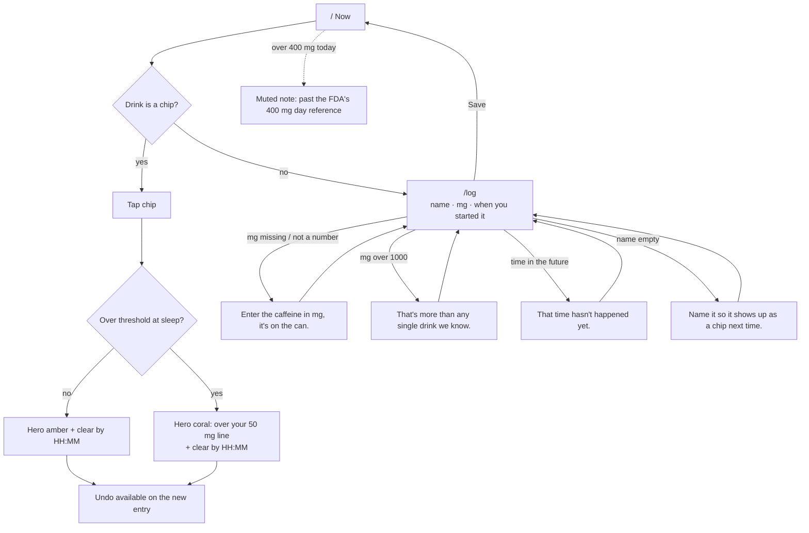
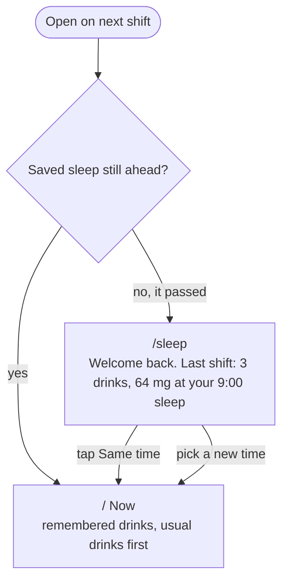

# Last Cup

**See how much caffeine will still be in you when you next sleep, whatever time of day that is.**

Built for people whose bedtime moves: night-shift nurses, rotating-shift healthcare workers, PhD students. Tap the drink you just had. Last Cup tells you how many mg will still be in you at your next sleep, at 9am after a night shift or 3pm on a swing shift, and when you'll be clear. No account, no quiz, nothing leaves your phone.

- Live: _deploying_
- Course: MPCS 51238 Design, Build, Ship, Assignment 3 (Patterns & Flows)

## Demo in 30 seconds

1. Open the app. One question: when are you sleeping next? Say 9:00.
2. Tap **Red Bull**. The chip already said "+30 mg at sleep", so you knew before you drank it.
3. Close it. Come back on your next shift: it says "Welcome back", remembers your drinks, and one tap keeps your usual sleep time.

## Flows

Main task, as one sentence:

> I log a Red Bull at 2am on my night shift → it shows how much will still be in me when I sleep at 9am → I come back on my next shift, and it remembers my drinks and my sleep times.

Worked out in plan mode on 16 October 2026. The agent proposed the steps, states and errors below; the user reviewed them and chose to go with the agent's recommendations.

### Steps (one route each, shared bottom nav)

| Route | Step |
|---|---|
| `/sleep` | When are you sleeping next? |
| `/` | Now: what will still be in you at sleep, plus one-tap drinks |
| `/log` | Log a drink that isn't a chip |
| `/settings` | Half-life, sleep threshold, clear data |

### 1. First visit


### 2. Main task: log a drink



### 3. Coming back



### States

- **First visit, nothing saved:** go straight to the sleep question, then the chips. No empty chart.
- **Under the threshold at sleep:** amber hero.
- **Over the threshold at sleep:** coral hero and "clear by HH:MM".
- **Chip would cross the threshold:** the chip's preview turns coral before you tap.
- **Returning, sleep passed:** welcome-back summary and a one-tap "Same time".
- **Returning, sleep ahead:** straight to Now.
- **Past 400 mg today:** a muted note (reference, not advice).

The diagrams also live in [`flows.md`](flows.md).

## The model

One-compartment exponential decay, `remaining = dose × 0.5^(hours / halfLife)`, summed over every drink. The half-life defaults to 5 h (adjustable from 2 to 10 h, since people vary). Absorption is treated as instant. The 50 mg sleep line is an adjustable heuristic, not medical advice. The 400 mg/day figure is the FDA's reference for most adults. Sources for every drink's mg value are in [`src/lib/drinks.ts`](src/lib/drinks.ts) and [`research.md`](research.md).

## Run it

```bash
npm install
npm run dev
```

Next.js (App Router) and Tailwind CSS. Data is saved in `localStorage` only.
