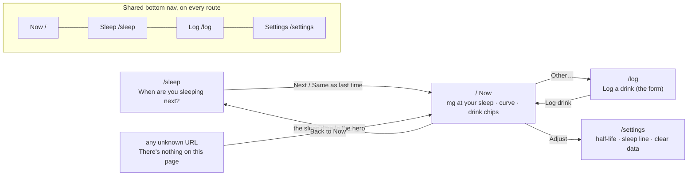
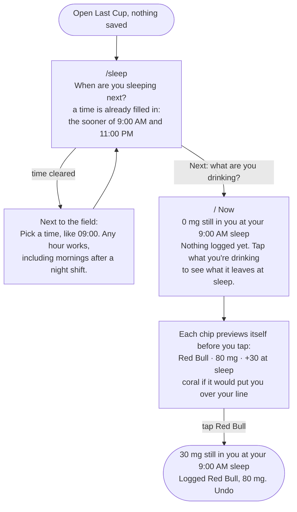
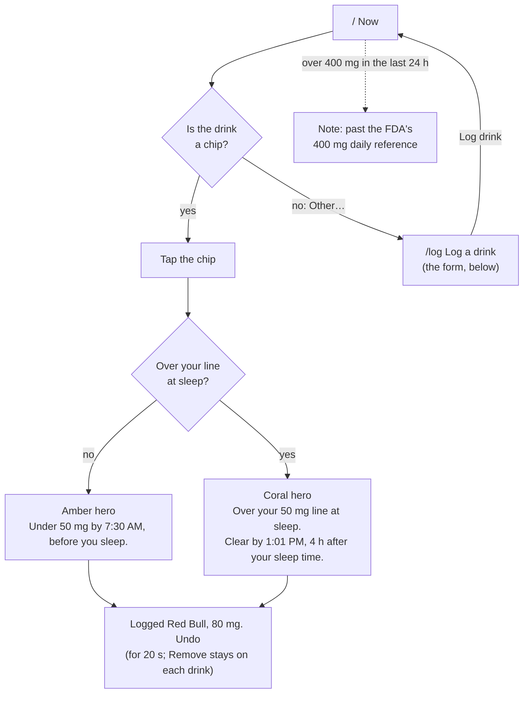
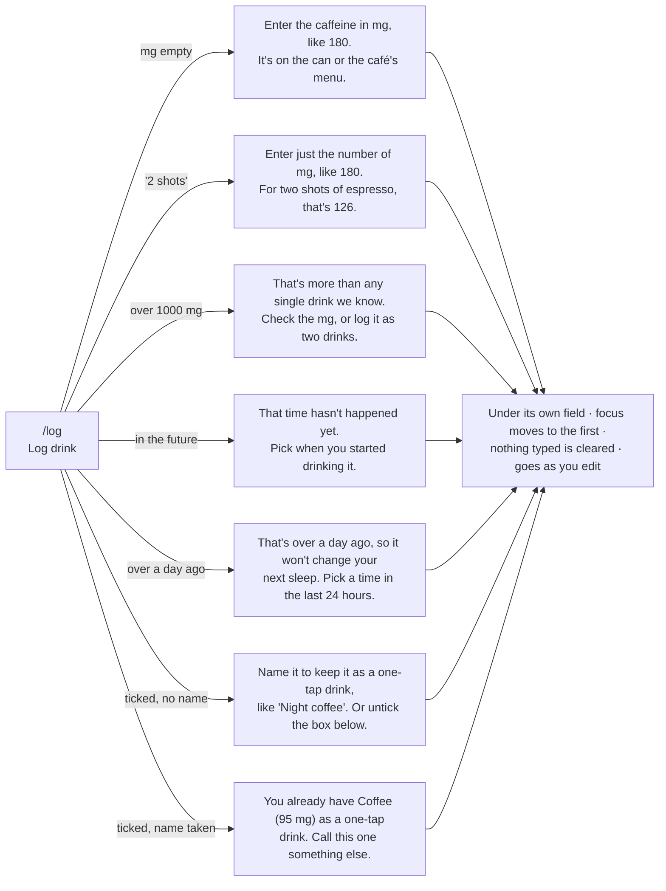
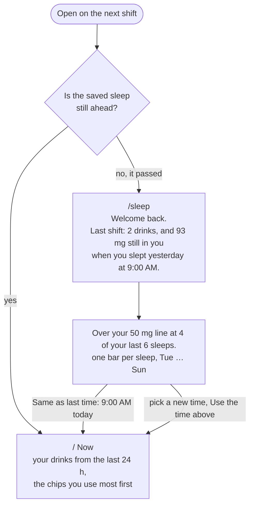

# Flows

Main task, as one sentence:

> I log a Red Bull at 2am on my night shift → it shows how much will still be in me when I sleep at 9am → I come back on my next shift, and it remembers my drinks and my sleep times.

Worked out with the agent in plan mode on 16 October 2026, then revised after two first-run checks and a strict review against the brief. The labels below are the app's actual wording. What the agent proposed, and what we kept or cut, is in the README under [Plan mode](README.md#plan-mode-what-the-agent-proposed-and-what-we-kept).

## Routes and navigation

One route per step. Every route sits in the same `Screen` frame, with the shared bottom nav (the current tab is amber and marked `aria-current="page"`) and the "Last Cup" wordmark, which links back to Now.

## 1. First visit: useful right away

Two taps from opening the app to the answer. No account, no quiz, no tour, and never an empty chart.

## 2. Main task: log a drink

### The form and its errors (`/log`)

Fields: **Drink** (optional for a one-off) · **Caffeine, in mg** · **When did you start it?** (defaults to now) · ☐ **Add it to my one-tap drinks** (unticked).

"180", "180 mg", "180mg large" and "1,000" are all read as numbers. Leave mid-form and come back, and the form says "Kept what you typed last time" with a **Start over** button.

## 3. Coming back: it remembers

Everything lives in `localStorage` on this device (`lastcup:v1`, plus `lastcup:draft` for a half-filled form): drinks for 30 days, the next sleep, the last 14 sleeps, settings and custom chips.

## States

| State | What you see |
|---|---|
| First visit, nothing saved | The sleep question with a time filled in, then chips that preview their effect. No empty chart. |
| Nothing logged yet | "0 mg" and "Nothing logged yet. Tap what you're drinking…" right above the chips |
| Under your line at sleep | Amber hero, "Under 50 mg by 7:30 AM, before you sleep." |
| Over your line at sleep | Coral hero, "Over your 50 mg line at sleep. Clear by …" |
| A chip would push you over | That chip turns coral before you tap, with a one-line key |
| Already over | "You're already over your 50 mg line at sleep, so each one adds to it." |
| Just logged or removed | "Logged Red Bull, 80 mg. Undo" for 20 s |
| Past 400 mg in 24 h | A muted note (a reference, not advice) |
| Returning, sleep passed | Welcome back, last shift, bars for recent sleeps, one-tap "Same as last time" |
| Returning, sleep still ahead | Straight to Now |
| Half-filled form | "Kept what you typed last time. Start over" |
| Unknown URL | "There's nothing on this page", with Back to Now |
| Storage blocked (private mode) | Works for the visit, kept in memory |

**A sleep time can't be in the past, by design.** "9:00" means the next time the clock reads 9:00, and the hint spells it out ("That's 9:00 AM today, in 4 h 49 min"). That removed an error we had planned, which is simpler than catching it.
